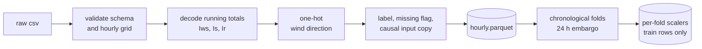
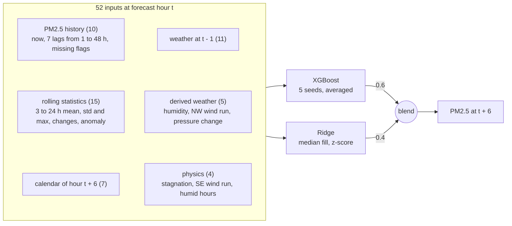
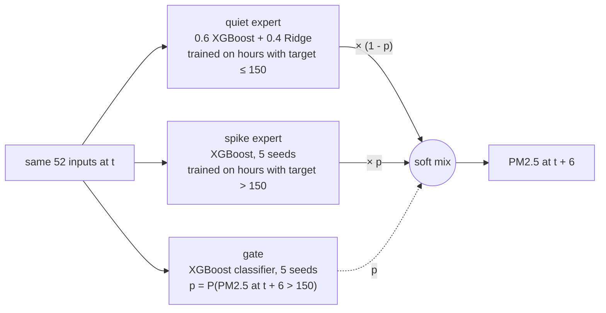

<div align="center">

# PM2.5 forecasting with gradient boosting and LSTM models

**Short-horizon air quality forecasting on hourly Beijing data: 2010 to 2013 to build the models, 2014 held out as the test year**

[](pyproject.toml)
[](#roadmap)
[](#roadmap)
[](https://archive.ics.uci.edu/dataset/381/beijing+pm2+5+data)
[](tests/test_data.py)

AML/DL Project 19 - Team T024, Section A

[Overview](#overview) -
[Dataset](#dataset) -
[Pipeline](#preprocessing-pipeline) -
[Evaluation](#evaluation-protocol) -
[Model](#phase-1-model) -
[Mixture of experts](#mixture-of-experts-at-6-h) -
[Quick start](#quick-start) -
[Structure](#repository-structure) -
[Roadmap](#roadmap) -
[Team](#team)

</div>

---

## Overview

This project forecasts the concentration of fine particulate matter (PM2.5) a short, fixed number of hours ahead from past pollution and weather, and asks a simple question: **how much does each modelling step add over just repeating the current value?**

| Stage | Approach | Status |
|:--|:--|:--|
| Exploratory analysis | On the original csv: data quality on all years, then patterns on 2010 to 2013 only | Done |
| Data preprocessing | Leak-free pipeline driven by the EDA findings, walkthrough notebook | Done |
| Data report | One IEEE report covering EDA and preprocessing: [`reports/data_report.pdf`](reports/data_report.pdf) | Done |
| Phase 1 (ML) | XGBoost and Ridge on lag, rolling, calendar, weather and physics features vs persistence and seasonal-naive baselines: [`notebooks/03_phase1_models.ipynb`](notebooks/03_phase1_models.ipynb) | Done, 2014 scored |
| Mixture of experts (6 h) | Quiet and spike experts split at 150 µg/m³, mixed hour by hour by a gate: [`notebooks/04_moe.ipynb`](notebooks/04_moe.ipynb) | Done, final model, 2014 scored once |
| Phase 1 report | IEEE report on the features, models, results and mixture of experts: [`reports/phase1_report.pdf`](reports/phase1_report.pdf) | Done |
| Phase 2 (DL) | LSTM or temporal CNN on fixed windows, then an optional ML + DL hybrid | Planned |

Every model is scored with expanding-window chronological backtests on MAE, RMSE and R2 at a fixed horizon, on exactly the same hours.

---

## Dataset

[UCI Beijing PM2.5](https://archive.ics.uci.edu/dataset/381/beijing+pm2+5+data): hourly PM2.5 from the US Embassy in Beijing, with weather from Beijing Capital International Airport.

<table>
<tr><td>

| | |
|:--|--:|
| Hourly rows | 43,824 |
| Period | 2010-01-01 to 2014-12-31 |
| Target missing | 4.72% (2,067 h) |
| Weather missing | 0 |
| Target median / max | 72 / 994 ug/m3 |

</td><td>

| Variable | Meaning |
|:--|:--|
| `pm2.5` | PM2.5 concentration, target |
| `DEWP` / `TEMP` / `PRES` | dew point, temperature, pressure |
| `cbwd` | wind direction: NE, NW, SE, cv (calm or variable) |
| `Iws` | cumulated wind speed |
| `Is` / `Ir` | cumulated hours of snow / rain |

</td></tr>
</table>

**What the EDA found** (patterns measured on 2010 to 2013; the 2014 test year stays unseen)

- **Strong persistence.** Autocorrelation is 0.96 at 1 hour, 0.39 at 24 hours and 0.01 at one week, so the seasonal-naive baseline uses a 24-hour lag.
- **Daily and seasonal cycles.** The hourly mean peaks at 01:00 (114) and is lowest at 15:00 (86); monthly means range from 80.6 in April to 115.1 in October. Winter and summer have opposite daily shapes.
- **Wind and humidity drive pollution.** Mean PM2.5 is 127 under calm wind and 69 under north-west wind, and relative humidity has the strongest same-hour rank correlation with PM2.5 (0.54); six hours ahead, wind speed is stronger (-0.46 against 0.39).
- **Running totals, not readings.** `Iws`, `Is` and `Ir` accumulate until the wind direction or weather changes, so they are decoded before use.
- **Heavy right tail.** Skewness 1.8, reduced to -0.3 by log1p. The two highest values fall in the first hours of the Lunar New Year and are kept as real episodes.

---

## Preprocessing pipeline



| Step | What it does | Why |
|:--|:--|:--|
| Validate | Exact columns, complete hourly grid, no missing weather | Fail loudly instead of repairing silently |
| Decode | `Iws` to hourly wind speed, `Is` / `Ir` to snow and rain flags | The raw columns are running totals |
| Encode | Four wind-direction columns in a fixed order | Same columns in every fold |
| Missing target | Label untouched, `pm25_miss` flag, `pm25_in` forward-filled for at most 3 h | Interpolation would use values after the gap |
| Folds | Validate on 2011, 2012, 2013; test on 2014 | Every fold sees a full seasonal cycle |
| Scale | log1p for skewed columns, then z-score from training rows only | No statistics from evaluation years |

Full reasoning, figures and numbers for the EDA and preprocessing: [`reports/data_report.pdf`](reports/data_report.pdf).

---

## Evaluation protocol

| Fold | Train | Evaluate | Train hours | Labelled eval hours |
|:--|:--|:--|--:|--:|
| cv1 | 2010 | 2011 | 8,736 | 8,032 |
| cv2 | 2010 - 2011 | 2012 | 17,496 | 8,295 |
| cv3 | 2010 - 2012 | 2013 | 26,280 | 8,678 |
| test | 2010 - 2013 | 2014 | 35,040 | 8,661 |

Each training span stops 24 hours before its evaluation year, so no training target can fall inside it for horizons up to 24 hours. Each final model is scored once on 2014, after its settings are fixed.

**Leakage guarantees, each checked by a test in [`tests/test_data.py`](tests/test_data.py)**

- the filled input at hour t is identical whether or not later hours exist
- folds never overlap and respect the embargo
- scaler statistics do not change when evaluation or later rows change
- the target label is never modified

---

## Phase 1 model

One direct model per horizon: the inputs describe hour t and the target is PM2.5 at t + h. The headline 6 h model:



| Part | Setting at 6 h | How it was chosen |
|:--|:--|:--|
| Inputs | 52 columns in six groups, none from after hour t | groups added one at a time; each lowered the validation error |
| XGBoost | depth 4, min child weight 20, column sample 0.5, subsample 1.0, L2 penalty 1 | best of 20 random candidates on 2011 to 2013 |
| Trees | early stopping, then a refit on the whole training span | early stopping on the last 90 days of each training span |
| Target | PM2.5 level in µg/m³ | lower validation RMSE than log1p and a change target |
| Ridge | alpha 10; log1p on the PM2.5 level inputs, median fill, z-score | alpha from 0.1 to 1000 on 2011 to 2013 |
| Blend | 0.6 XGBoost + 0.4 Ridge | weights on a 0.1 grid on 2011 to 2013; a 0.9-quantile spike expert was offered and got weight 0 |

---

## Phase 1 results

Every choice (settings, target form, Ridge alpha, blend weights) was made on 2011 to 2013 by RMSE. The 2014 test year was then scored once. The selected Phase 1 model is a blend of a 5-seed XGBoost ensemble and Ridge; the final model is the [mixture of experts](#mixture-of-experts-at-6-h) built on it.

| Horizon | Persistence RMSE | Best model RMSE | Better by | R2 | MAE |
|:--|--:|--:|--:|--:|--:|
| 1 h | 21.98 | 20.64 | 6.1% | 0.951 | 11.30 |
| **6 h** | 61.22 | **51.96** | **15.1%** | **0.690** | 33.93 |
| 24 h | 99.02 | 81.49 | 17.7% | 0.241 | 59.78 |

Units are µg/m³. After the PM2.5 lags, weather adds the most of any feature group; the physics group (stagnation, southerly transport, humid hours) adds a little more. Validation scores, ablation and feature importance are in [`reports/phase1/`](reports/phase1/).

Full write-up: [`reports/phase1_report.pdf`](reports/phase1_report.pdf).

Training and validation scores side by side, for bias and variance: [`notebooks/05_train_vs_validation.ipynb`](notebooks/05_train_vs_validation.ipynb).

How the 6 h model got here, run by run: [`reports/model_history.md`](reports/model_history.md).

---

## Mixture of experts at 6 h

Hours above 150 µg/m³ are 21% of the validation hours but half of the Phase 1 blend's squared error. The mixture splits the training hours at 150: a quiet expert with the Phase 1 recipe learns the hours at or below it, a spike expert the hours above, and a gate estimates for each hour the chance p that PM2.5 six hours later is above 150 and mixes the two experts by it. It was chosen as the final model on the validation years 2011 to 2013 and only then scored once on 2014.



| Model | RMSE | MAE | R2 |
|:--|--:|--:|--:|
| Phase 1 blend | 56.33 | 36.41 | 0.621 |
| Mixture of experts | 56.26 | 35.99 | 0.622 |
| Mixture with a perfect gate (uses the true label, not a forecast) | 39.46 | 27.29 | 0.814 |

The mixture lowers MAE by 1.1 to 1.3% in every seed set tried, but its RMSE gain is within seed noise. With a perfect gate the same experts would cut RMSE by 30%, so the limit is spotting when an episode starts or ends, not the experts. Details in [`reports/moe/`](reports/moe/) and the model history.

**2014 test, scored once after the choice was fixed**

| Model | RMSE | MAE | R2 |
|:--|--:|--:|--:|
| Persistence | 61.22 | 38.67 | 0.569 |
| Phase 1 blend | 51.96 | 33.93 | 0.690 |
| Mixture of experts (final) | 51.86 | 33.69 | 0.691 |

MAE is 0.7% lower than the blend, less than the 1.2% on validation; the RMSE difference is within seed noise.

---

## Quick start

```bash
git clone https://github.com/Vetri-78640/aml_dl_pm2.5.git
cd aml_dl_pm2.5
pip install -e ".[dev]"

python -m aqf.data.pipeline          # build data/interim and data/processed
pytest                               # run the tests
```

| Task | Command |
|:--|:--|
| Regenerate data report figures | `python scripts/plot_data_report.py` |
| Rebuild the data report PDF | `cd reports && tectonic data_report.tex` |
| Regenerate Phase 1 report figures | `python scripts/plot_phase1_report.py` |
| Rebuild the Phase 1 report PDF | `cd reports && tectonic phase1_report.tex` |
| Re-run the EDA | `jupyter nbconvert --to notebook --execute --inplace notebooks/01_eda.ipynb` |
| Re-run the preprocessing walkthrough | `jupyter nbconvert --to notebook --execute --inplace notebooks/02_data_preprocessing.ipynb` |

Data settings live in [`configs/data.yaml`](configs/data.yaml): fill limit, fold years, embargo length and scaled columns. Model settings live in [`configs/phase1.yaml`](configs/phase1.yaml): horizons, features, selection metric, search space and seeds. The mixture of experts reads the frozen Phase 1 choices and its own settings from [`configs/moe.yaml`](configs/moe.yaml).

**Outputs**

| Path | Contents |
|:--|:--|
| `data/interim/hourly.parquet` | cleaned hourly frame, 17 columns |
| `data/processed/folds.json` | fold boundaries |
| `data/processed/scalers/*.json` | one scaler per fold, fitted on training rows |
| `reports/data/qa.json` | audit numbers used in the report |
| `reports/phase1_report.pdf`, `reports/data_report.pdf` | the two IEEE reports, with their LaTeX sources |
| `reports/phase1/` | Phase 1 report figures, validation scores, search, ablation, importance, 2014 test scores and settings fingerprint |
| `reports/phase1/train_vs_validation.csv` | training against validation scores per fold, blend and mixture |
| `reports/moe/` | mixture of experts: scores, error breakdown, gate quality and calibration, lambda curve, seed check, 2014 test scores and settings fingerprint |
| `reports/model_history.md` | every step of the 6 h model with its scores |

---

## Repository structure

```
aml_dl_pm2.5/
├── configs/
│   ├── data.yaml                  pipeline settings
│   ├── phase1.yaml                model settings
│   └── moe.yaml                   mixture of experts settings
├── data/
│   ├── raw/                       original csv, never modified
│   ├── interim/                   cleaned hourly frame (generated)
│   └── processed/                 folds and per-fold scalers (generated)
├── notebooks/
│   ├── 01_eda.ipynb               EDA on the original csv
│   ├── 02_data_preprocessing.ipynb  applies the EDA decisions
│   ├── 03_phase1_models.ipynb     baselines, Ridge, XGBoost, 2014 test
│   ├── 04_moe.ipynb               mixture of experts at 6 h, 2014 test
│   └── 05_train_vs_validation.ipynb  training against validation scores
├── reports/
│   ├── phase1_report.pdf          IEEE Phase 1 report
│   ├── data_report.pdf            IEEE data report (EDA + preprocessing)
│   ├── data/                      data report figures, audit summary
│   ├── phase1/                    Phase 1 figures, validation and test scores
│   ├── moe/                       mixture of experts scores
│   └── model_history.md           how the 6 h model got here
├── scripts/
│   ├── plot_data_report.py        data report figures
│   └── plot_phase1_report.py      Phase 1 report figures
├── src/aqf/
│   ├── config.py                  config loader
│   ├── features.py                feature builders, calendar, humidity, physics
│   ├── models.py                  baselines, Ridge, XGBoost, gate
│   ├── metrics.py                 MAE, RMSE, R2, bias
│   ├── viz.py                     shared figures
│   └── data/                      load, clean, split, scale, audit, pipeline
├── tests/
│   ├── test_data.py
│   └── test_features.py
└── pyproject.toml
```

---

## Roadmap

- [x] Exploratory data analysis on the original data
- [x] Leak-free preprocessing pipeline
- [x] Walkthrough notebooks and one IEEE data report for EDA and preprocessing
- [x] Feature engineering: lags, rolling statistics, calendar, weather and physics features
- [x] Persistence, 24-hour seasonal-naive and linear baselines
- [x] XGBoost with chronological tuning and feature-group ablation
- [x] Mixture of experts at 6 h: quiet expert, spike expert and gate
- [x] Phase 1 report and presentation
- [ ] LSTM or temporal CNN on fixed windows
- [ ] ML + DL hybrid with ablation studies
- [ ] Phase 2 report and presentation

---

## Team

| Name |
|:--|
| Vetriselvan R |
| Hrishi Dongre |
| Pampana Sree Adithya |
| Ishan Goyal |
| Vedant Madne |

---

## References

1. S. Chen, "Beijing PM2.5," UCI Machine Learning Repository, 2015. [doi:10.24432/C5JS49](https://doi.org/10.24432/C5JS49). Licensed CC BY 4.0.
2. X. Liang et al., "Assessing Beijing's PM2.5 pollution: severity, weather impact, APEC and winter heating," *Proc. R. Soc. A*, vol. 471, no. 2182, 2015.
3. R. J. Hyndman and G. Athanasopoulos, *Forecasting: Principles and Practice*, 3rd ed., OTexts, 2021.
4. T. Chen and C. Guestrin, "XGBoost: A scalable tree boosting system," *KDD*, 2016.
5. S. Hochreiter and J. Schmidhuber, "Long short-term memory," *Neural Computation*, 1997.
