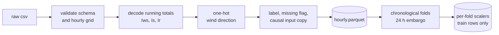

<div align="center">

# PM2.5 forecasting with gradient boosting and LSTM models

**Short-horizon air quality forecasting on hourly Beijing data: 2010 to 2013 to build the models, 2014 held out as the test year**

[](pyproject.toml)
[](#roadmap)
[](#roadmap)
[](https://archive.ics.uci.edu/dataset/381/beijing+pm2+5+data)
[](tests/test_data.py)

AML/DL Project 19 - Team T024, Section A

[Overview](#overview) -
[Dataset](#dataset) -
[Pipeline](#preprocessing-pipeline) -
[Evaluation](#evaluation-protocol) -
[Quick start](#quick-start) -
[Structure](#repository-structure) -
[Roadmap](#roadmap) -
[Team](#team)

</div>

---

## Overview

This project forecasts the concentration of fine particulate matter (PM2.5) a short, fixed number of hours ahead from past pollution and weather, and asks a simple question: **how much does each modelling step add over just repeating the current value?**

| Stage | Approach | Status |
|:--|:--|:--|
| Exploratory analysis | On the original csv: data quality on all years, then patterns on 2010 to 2013 only | Done |
| Data preprocessing | Leak-free pipeline driven by the EDA findings, walkthrough notebook | Done |
| Data report | One IEEE report covering EDA and preprocessing: [`reports/data/data_report.pdf`](reports/data/data_report.pdf) | Done |
| Phase 1 (ML) | XGBoost and Ridge on lag, rolling, calendar, weather and physics features vs persistence and seasonal-naive baselines: [`notebooks/03_phase1_models.ipynb`](notebooks/03_phase1_models.ipynb) | Done, 2014 scored |
| Phase 2 (DL) | LSTM or temporal CNN on fixed windows, then an optional ML + DL hybrid | Planned |

Every model is scored with rolling chronological backtests on MAE, RMSE and R2 at a fixed horizon, on exactly the same hours.

---

## Dataset

[UCI Beijing PM2.5](https://archive.ics.uci.edu/dataset/381/beijing+pm2+5+data): hourly PM2.5 from the US Embassy in Beijing, with weather from Beijing Capital International Airport.

<table>
<tr><td>

| | |
|:--|--:|
| Hourly rows | 43,824 |
| Period | 2010-01-01 to 2014-12-31 |
| Target missing | 4.72% (2,067 h) |
| Weather missing | 0 |
| Target median / max | 72 / 994 ug/m3 |

</td><td>

| Variable | Meaning |
|:--|:--|
| `pm2.5` | PM2.5 concentration, target |
| `DEWP` / `TEMP` / `PRES` | dew point, temperature, pressure |
| `cbwd` | wind direction: NE, NW, SE, cv (calm or variable) |
| `Iws` | cumulated wind speed |
| `Is` / `Ir` | cumulated hours of snow / rain |

</td></tr>
</table>

**What the EDA found** (patterns measured on 2010 to 2013; the 2014 test year stays unseen)

- **Strong persistence.** Autocorrelation is 0.96 at 1 hour, 0.39 at 24 hours and 0.01 at one week, so the seasonal-naive baseline uses a 24-hour lag.
- **Daily and seasonal cycles.** The hourly mean peaks at 01:00 (114) and is lowest at 15:00 (86); monthly means range from 80.6 in April to 115.1 in October. Winter and summer have opposite daily shapes.
- **Wind and humidity drive pollution.** Mean PM2.5 is 127 under calm wind and 69 under north-west wind, and relative humidity has the strongest rank correlation with PM2.5 (0.54).
- **Running totals, not readings.** `Iws`, `Is` and `Ir` accumulate until the wind direction or weather changes, so they are decoded before use.
- **Heavy right tail.** Skewness 1.8, reduced to -0.3 by log1p. The two highest values fall in the first hours of the Lunar New Year and are kept as real episodes.

---

## Preprocessing pipeline



| Step | What it does | Why |
|:--|:--|:--|
| Validate | Exact columns, complete hourly grid, no missing weather | Fail loudly instead of repairing silently |
| Decode | `Iws` to hourly wind speed, `Is` / `Ir` to snow and rain flags | The raw columns are running totals |
| Encode | Four wind-direction columns in a fixed order | Same columns in every fold |
| Missing target | Label untouched, `pm25_miss` flag, `pm25_in` forward-filled for at most 3 h | Interpolation would use values after the gap |
| Folds | Validate on 2011, 2012, 2013; test on 2014 | Every fold sees a full seasonal cycle |
| Scale | log1p for skewed columns, then z-score from training rows only | No statistics from evaluation years |

Full reasoning, figures and numbers for the EDA and preprocessing: [`reports/data/data_report.pdf`](reports/data/data_report.pdf).

---

## Evaluation protocol

| Fold | Train | Evaluate | Train hours | Labelled eval hours |
|:--|:--|:--|--:|--:|
| cv1 | 2010 | 2011 | 8,736 | 8,032 |
| cv2 | 2010 - 2011 | 2012 | 17,496 | 8,295 |
| cv3 | 2010 - 2012 | 2013 | 26,280 | 8,678 |
| test | 2010 - 2013 | 2014 | 35,040 | 8,661 |

Each training span stops 24 hours before its evaluation year, so no training target can fall inside it for horizons up to 24 hours. 2014 is scored once, at the end.

**Leakage guarantees, each checked by a test in [`tests/test_data.py`](tests/test_data.py)**

- the filled input at hour t is identical whether or not later hours exist
- folds never overlap and respect the embargo
- scaler statistics do not change when evaluation or later rows change
- the target label is never modified

---

## Phase 1 results

Every choice (settings, target form, Ridge alpha, blend weights) was made on 2011 to 2013 by RMSE. The 2014 test year was then scored once. The selected model is a blend of a 5-seed XGBoost ensemble and Ridge.

| Horizon | Persistence RMSE | Best model RMSE | Better by | R2 | MAE |
|:--|--:|--:|--:|--:|--:|
| 1 h | 21.98 | 20.64 | 6.1% | 0.951 | 11.30 |
| **6 h** | 61.22 | **51.96** | **15.1%** | **0.690** | 33.93 |
| 24 h | 99.02 | 81.49 | 17.7% | 0.241 | 59.78 |

Units are µg/m³. After the PM2.5 lags, weather adds the most of any feature group; the physics group (stagnation, southerly transport, humid hours) adds a little more. Validation scores, ablation and feature importance are in [`reports/phase1/`](reports/phase1/).

---

## Quick start

```bash
git clone https://github.com/Vetri-78640/aml_dl_pm2.5.git
cd aml_dl_pm2.5
pip install -e ".[dev]"

python -m aqf.data.pipeline          # build data/interim and data/processed
pytest                               # run the tests
```

| Task | Command |
|:--|:--|
| Regenerate report figures | `python scripts/plot_data_report.py` |
| Rebuild the report PDF | `cd reports/data && tectonic data_report.tex` |
| Re-run the EDA | `jupyter nbconvert --to notebook --execute --inplace notebooks/01_eda.ipynb` |
| Re-run the preprocessing walkthrough | `jupyter nbconvert --to notebook --execute --inplace notebooks/02_data_preprocessing.ipynb` |

Data settings live in [`configs/data.yaml`](configs/data.yaml): fill limit, fold years, embargo length and scaled columns. Model settings live in [`configs/phase1.yaml`](configs/phase1.yaml): horizons, features, selection metric, search space and seeds.

**Outputs**

| Path | Contents |
|:--|:--|
| `data/interim/hourly.parquet` | cleaned hourly frame, 17 columns |
| `data/processed/folds.json` | fold boundaries |
| `data/processed/scalers/*.json` | one scaler per fold, fitted on training rows |
| `reports/data/qa.json` | audit numbers used in the report |
| `reports/phase1/` | validation scores, search, ablation, importance, 2014 test scores and settings fingerprint |

---

## Repository structure

```
aml_dl_pm2.5/
├── configs/
│   ├── data.yaml                  pipeline settings
│   └── phase1.yaml                model settings
├── data/
│   ├── raw/                       original csv, never modified
│   ├── interim/                   cleaned hourly frame (generated)
│   └── processed/                 folds and per-fold scalers (generated)
├── notebooks/
│   ├── 01_eda.ipynb               EDA on the original csv
│   ├── 02_data_preprocessing.ipynb  applies the EDA decisions
│   └── 03_phase1_models.ipynb     baselines, Ridge, XGBoost, 2014 test
├── reports/
│   ├── data/                      IEEE data report (EDA + preprocessing), figures, audit summary
│   └── phase1/                    validation and test scores
├── scripts/
│   └── plot_data_report.py        data report figures
├── src/aqf/
│   ├── config.py                  config loader
│   ├── features.py                feature builders, calendar, humidity, physics
│   ├── models.py                  baselines, Ridge, XGBoost
│   ├── metrics.py                 MAE, RMSE, R2, bias
│   ├── viz.py                     shared figures
│   └── data/                      load, clean, split, scale, audit, pipeline
├── tests/
│   ├── test_data.py
│   └── test_features.py
└── pyproject.toml
```

---

## Roadmap

- [x] Exploratory data analysis on the original data
- [x] Leak-free preprocessing pipeline
- [x] Walkthrough notebooks and one IEEE data report for EDA and preprocessing
- [x] Feature engineering: lags, rolling statistics, calendar, weather and physics features
- [x] Persistence, 24-hour seasonal-naive and linear baselines
- [x] XGBoost with chronological tuning and feature-group ablation
- [ ] Phase 1 report and presentation
- [ ] LSTM or temporal CNN on fixed windows
- [ ] ML + DL hybrid with ablation studies
- [ ] Phase 2 report and presentation

---

## Team

| Name |
|:--|
| Vetriselvan R |
| Hrishi Dongre |
| Pampana Sree Adithya |
| Ishan Goyal |
| Vedant Madne |

---

## References

1. S. Chen, "Beijing PM2.5," UCI Machine Learning Repository, 2015. [doi:10.24432/C5JS49](https://doi.org/10.24432/C5JS49). Licensed CC BY 4.0.
2. X. Liang et al., "Assessing Beijing's PM2.5 pollution: severity, weather impact, APEC and winter heating," *Proc. R. Soc. A*, vol. 471, no. 2182, 2015.
3. R. J. Hyndman and G. Athanasopoulos, *Forecasting: Principles and Practice*, 3rd ed., OTexts, 2021.
4. T. Chen and C. Guestrin, "XGBoost: A scalable tree boosting system," *KDD*, 2016.
5. S. Hochreiter and J. Schmidhuber, "Long short-term memory," *Neural Computation*, 1997.
